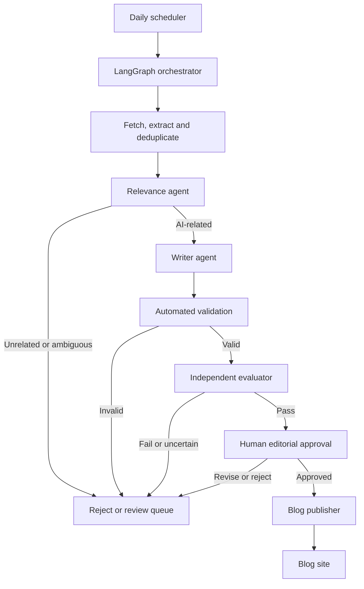

# AI Signalwire

AI Signalwire is a daily AI news publishing pipeline. A scheduler starts a run each day. Plain code steps find and clean up recent articles from leading AI organizations. Two LLM agents then check whether each article is genuinely about AI and write a source-linked post for the blog.

A separate evaluator checks the agents' decisions and drafts before anything can move to publication. LangGraph coordinates the stateful workflow and sequential steps; the LLM components use LangChain.

The design keeps the number of agents small: only steps that need language understanding are agents. Everything else is deterministic code.

A working laptop demo runs the whole flow from a Jupyter notebook. See [Run the demo](#run-the-demo).

## Sources

Sources are listed in `config/sources.yaml`, and each can be switched off individually.

- **Frontier labs** (first to announce models, tools, frameworks, and protocols): OpenAI, Google DeepMind, Google AI, Anthropic, Meta AI, Microsoft, AWS ML, NVIDIA, and Mistral. Most are read from RSS/Atom feeds. Anthropic and Meta AI have no official feed, so a small page reader collects links from their news index, respecting `robots.txt` and rate limits.
- **Framework releases** (catch framework shifts on release day): the GitHub releases feed for MCP, LangChain, LangGraph, LlamaIndex, CrewAI, and the OpenAI Agents SDK. Add more repositories to the config to extend the watchlist.

Each item is tagged `lab_post` or `release`. The writer agent uses a news-summary style for posts and a release-notes style for releases. The relevance agent still checks every item.

## High-level workflow



LangGraph manages the run state, step order, conditional routing, retries, and review handoffs. LangChain supplies reusable components for the LLM agents, such as model calls, prompts, and structured output parsing.

## Daily workflow

The scheduler starts one run per day at a configurable time. Each run gets a unique ID and processes the configured [sources](#sources). For every new article, the orchestrator runs these steps in order.

**Code steps (no LLM)**

1. **Fetch and extract**—Checks configured feeds for new articles, preferring RSS/Atom feeds, sitemaps, or documented APIs, with respectful, rate-limited page fetching when needed. Retrieves the article text and normalizes the title, publisher, canonical URL, publication date, and body into a common record.
2. **Deduplicate**—Checks the canonical URL and content fingerprint against stored items. Previously seen articles are recorded as duplicates and do not continue.

**Agents (LLM)**

3. **Relevance agent**—Decides whether the article is substantially about artificial intelligence. It assigns a relevance label and score, records the evidence for its decision, and routes unrelated or ambiguous items to a rejected or review state.
4. **Writer agent**—For relevant articles, writes an original, concise summary grounded in the source and returns it directly in the blog's required format: headline, slug, excerpt, body, topic tags, source attribution, canonical source URL, and publication date. It preserves key facts and attribution and does not reproduce the full article.

**Code step (no LLM)**

5. **Automated validation**—Checks required fields, link status, date format, and payload schema. Drafts that fail go to the review queue.

The orchestrator advances an article only after the current stage succeeds. Each step is persisted and retryable so a temporary failure does not require repeating successful stages or create duplicate posts.

## Independent evaluator

The third agent is a separate evaluator that checks the relevance decision and the resulting blog draft before publication. It runs with its own prompt, and ideally a different model, so it doesn't share the other agents' blind spots. It reads the original source material and draft, then independently answers:

- Is the article substantially about AI, rather than merely mentioning AI in passing?
- Does the evidence cited by the relevance agent support its decision?
- Is the summary faithful to the source, with no invented claims or misleading omissions?
- Does the formatted post retain a working source link, attribution, and publication date?

The evaluator returns `pass`, `reject_non_ai`, or `needs_review`, with a reason and supporting evidence. A non-AI article is blocked from publication. Ambiguous cases, evaluator disagreement, missing source text, and evaluation errors go to review. Only a passing item can enter the publication review queue. Store evaluator results alongside the agent outputs so relevance quality can be measured over time.

## Review and publishing

The initial system requires human approval before publishing. An editor can approve, revise, or reject a passing draft. After approval, the publisher adapter sends the blog-ready payload to the selected frontend or CMS and stores the resulting post URL and status. Automatic publishing can be considered after the relevance evaluator and editorial quality checks have proven reliable.

## Blog post format

The formatter should produce a stable payload that can be mapped to the chosen blog API. A starting schema:

```json
{
  "title": "Article headline",
  "slug": "article-headline",
  "excerpt": "One or two sentence preview.",
  "body_markdown": "Original summary with source attribution.",
  "topics": ["research"],
  "source_name": "Publisher",
  "source_url": "https://example.com/original-article",
  "source_published_at": "2026-01-01T12:00:00Z",
  "status": "pending_review"
}
```

The schema will be adapted to the existing blog frontend or CMS. The original source URL and publisher attribution must appear in every published post.

## Proposed architecture

- **Daily scheduler** starts the workflow and assigns a run ID.
- **LangGraph orchestrator** runs the workflow nodes sequentially, persists workflow state, handles retries, and routes items based on relevance, validation, and evaluation results.
- **LangChain components** provide model interactions, prompts, and structured outputs for the three agents.
- **Source adapters** (code) retrieve, extract, and deduplicate content from configured publishers.
- **Two workflow agents** classify AI relevance and write the formatted post.
- **Validation step** (code) checks required fields, links, dates, and schema.
- **Independent evaluator** (third agent) checks AI relevance and draft fidelity before publication review.
- **Review queue** holds passing drafts for editorial approval and ambiguous cases for investigation.
- **Publisher adapter** sends approved posts to the blog frontend or CMS.
- **Database** stores source items, agent outputs, evaluations, review state, and publication records.

## Stack

The demo column is what is built today. The production column is the suggested next step and can be swapped to fit the existing frontend.

| Area | Demo (built) | Production (suggested) |
|---|---|---|
| Language | Python 3.13 | Python or TypeScript |
| Orchestration | LangGraph | LangGraph |
| Agent framework | LangChain with Azure OpenAI or OpenAI, chosen from `.env` | LangChain |
| Scheduling | Run the notebook cell | Daily scheduler or durable workflow trigger |
| Storage | SQLite | PostgreSQL |
| Content retrieval | RSS/Atom, GitHub release feeds, and a page reader for sites without feeds | Same, with more source adapters |
| Blog integration | Local blog view in the notebook | Publisher interface for the selected CMS or frontend API |
| Deployment | Laptop | Scheduled container or worker service |

## Repository layout

```text
.
├── README.md
├── demo.ipynb                 # Notebook demo (generated by scripts/make_notebook.py)
├── config/
│   └── sources.yaml           # Publisher feeds, release feeds, and source settings
├── src/
│   ├── discovery/             # Feed and page adapters, extraction, deduplication (code)
│   ├── agents/                # Relevance and writer agents
│   ├── validation/            # Field, link, date, and schema checks (code)
│   ├── evaluation/            # Independent evaluator agent
│   ├── review/                # Review queue and approval actions
│   ├── publishing/            # Local blog (demo) and publisher interface
│   ├── storage/               # SQLite persistence
│   └── pipeline.py            # LangGraph workflow
├── scripts/                   # check_sources.py, make_notebook.py
└── tests/
```

## Run the demo

The demo runs on a laptop from a Jupyter notebook. It uses SQLite and a local blog view, so there is nothing else to install.

```bash
python3.13 -m venv .venv && source .venv/bin/activate
pip install -r requirements.txt
cp .env.example .env        # then add your key
jupyter notebook demo.ipynb
```

In `.env`, set `AZURE_OPENAI_ENDPOINT` and `AZURE_OPENAI_API_KEY` to use Azure OpenAI, or `OPENAI_API_KEY` to use OpenAI. For Azure, `AGENT_MODEL` and `EVALUATOR_MODEL` are deployment names.

Run the cells top to bottom. The review cell has Approve and Reject buttons, and the blog cell shows published posts.

- **Rehearse offline:** set `DEMO_MODE=1` and `FAKE_LLM=1` to use five canned articles and a fake model, with no network or key.
- **Check the sources:** `python scripts/check_sources.py` fetches one item from each source. Fix or disable any that fail in `config/sources.yaml`.
- **Run the tests:** `pytest`.

## Article and workflow records

Store at least:

- Source name, source URL, canonical URL, title, and publication date
- Discovery time, content fingerprint, and extracted article text or permitted excerpt
- AI relevance label, score, evidence, and decision reason
- Summary, formatted blog payload, and validation result
- Independent evaluation result, evidence, reason, and evaluator version
- Workflow run ID, per-step status, attempt count, and error details
- Editorial status, approver action, published URL, and publication time

The demo uses these statuses: `discovered`, `rejected_non_ai`, `needs_review`, `formatted`, `pending_review`, `approved`, `published`, and `failed`. The code also reserves `extracted`, `duplicate`, `summarized`, and `evaluation_failed`, which nothing sets yet. Duplicates are skipped before they are stored.

## Editorial and reliability principles

- Use official publisher sources as the source of record.
- Treat source text as untrusted input; article content must not override workflow instructions or cause agents to publish or execute unrelated actions.
- Preserve the source URL, publisher attribution, and publication date on every post.
- Clearly distinguish source facts from generated commentary.
- Do not invent details when the source is unclear; flag uncertainty for review.
- Respect publisher terms, robots guidance, rate limits, and copyright. Prefer feeds and APIs over scraping where available.
- If relevance evaluation fails or returns an ambiguous result, block automatic progression and send the item to review.
- Make processing idempotent so reruns do not produce duplicate drafts or posts.
- Keep logs sufficient to trace which source, agent outputs, and evaluation informed each publication.

## Initial milestones

1. Configure the daily scheduler and source registry; collect new items from one official feed.
2. Normalize and persist article records, with duplicate detection.
3. Add the relevance agent and the writer agent.
4. Add the automated validation step and the independent evaluator, and verify that unrelated articles are blocked or flagged.
5. Map the writer's output to the blog API and add the human review queue.
6. Publish an approved draft to a test blog endpoint; add retries, monitoring, and operational alerts.

## Project status

**Stage:** Laptop demo implemented and tested with a fake model and canned articles: all 76 tests pass, and all 15 configured sources return items. It has not yet been run end to end with a real Azure OpenAI or OpenAI key. LangChain and LangGraph are selected for the agent and workflow layers.

**Known limits of the demo:**
- No daily scheduler. A notebook cell starts each run.
- Items from sites that block bots, or whose feed gives only a short summary, produce thin drafts or go to review.
- Some review and status edge cases are deferred, such as rejecting an already published post.

**Still to be selected:** the scheduler time, frontend or CMS, and deployment target.
